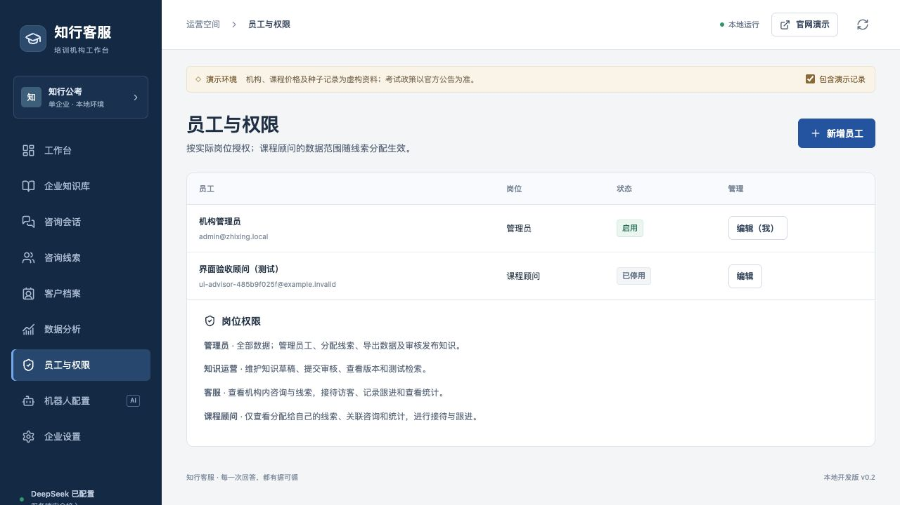
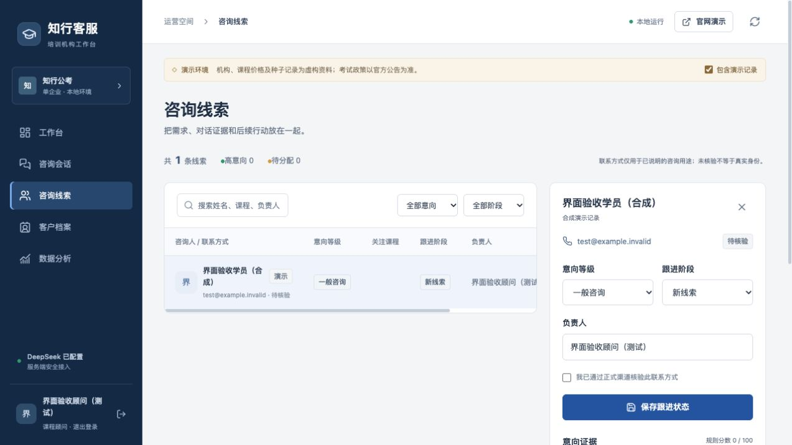

# v0.2 优化编号 1–3 验收记录

日期：2026-10-26。本轮仅实现用户确认的编号 1、2、3；保留单企业、本机 Docker 与既有 DeepSeek 配置。

## 已实现

1. **持续意向与多需求**：按完整用户消息顺序分析，分别记录考试需求、取消/恢复、试听/询价、咨询目的及消息证据。取消后的礼貌或中性消息不恢复旧分数。售后追问不参与购买评分，新购买需求采用新的证据。联系许可独立维护，只能主动再次提交授权恢复。升级旧摘要时保留人工确认等级。
2. **员工与权限**：管理员、知识运营、客服、课程顾问四种岗位；新增、停用、重设密码、调整岗位。负责人以员工 ID 分配。服务端同时限制列表、详情、嵌套线索、跟进和统计；旧接待人不能绕过当前线索归属。停用、改岗、改密撤销旧会话，保留最后一名可用管理员。
3. **知识生命周期**：草稿与正式快照独立；提交后锁定，管理员发布/退回/下架；历史预览和回滚为新版本；修订序号及 PostgreSQL 行锁避免并发覆盖。记录考试、地区、年度、来源、有效期及负责人。过期/未生效/内部/下架资料不进入公开回答或旧回答重放。各考试分别维护政策背景，跨地区/年度后的模型上下文排除不适用旧答案。

## 验证证据

- 后端完整回归：**63 项通过，8 个子测试通过**。测试使用隔离 SQLite，关闭 DeepSeek Key 和向量后台加载。
- 前端传输测试：**4 项通过**；TypeScript 与 Vite 生产构建通过。
- 从升级前 PostgreSQL 备份恢复到专用演练库，验证迁移前后原始数据数量不变：管理员 1、知识 20、会话 10、消息 23、线索 9、跟进 2。重复迁移、知识历史补建、发布与回滚均通过。
- 两个同时编辑同一知识的请求分别返回 **200 / 409**，冲突未覆盖内容。真实 PostgreSQL 复核顾问范围、重分配撤权、旧接待记录不能越权、停用会话。
- 实际容器 API 冒烟：认证、公开检索、内部资料隔离、未知问题、留资、转人工、人工回复、访客会话隔离和演示排除通过。DeepSeek 配置仍在，中文混合检索 ready；本轮自动验收没有新增付费模型调用。
- 浏览器：草稿保存、提交锁定、管理员发布、检索命中、版本预览、回滚为新版本和下架通过；顾问仅见本人合成线索、负责人只读、无分配/导出入口、添加跟进通过；停用后重新加载回到登录页。验收员工已停用，合成会话和线索已标记演示，验收知识已下架。
- 一次独立上下文代码审阅发现 4 类问题，均先复现失败回归后修复：直接取消表达及询价取消、售后上下文、跨考试政策背景、旧接待归属越权。修复后完整套件为 63 项及 8 个子测试通过；未重复派发审阅。

## 产品决定与边界

- 沿用本地现有功能分支，便于源代码与 Docker 服务保持一致；未增加另一份工作区隔离。
- 客服可接待全机构；顾问仅本人范围；分配、导出、员工管理、知识发布由管理员负责，代价是交接及发布需要管理员操作。
- 旧版文字负责人不按同名自动绑定，代价是管理员需要为旧线索重新选择实际员工。
- 具体政策缺失年度、地区或考试时先澄清；通用说明可以不限年度。代价是需要持续人工维护政策范围与来源。
- 每份知识只有一个正式快照。发布未来生效版本会替换旧版并暂停引用，界面已提示；如需旧版持续服务，应临近生效时再发布，当前没有多版本自动排期。
- 仍保留现有 300 会话、500 线索/知识列表和 5,000 候选切片限制；完整分页、大规模数据库召回、多进程同时初始化和 SaaS 多租户不属于本轮。代价是扩大规模或部署集群前需继续开发与验收。
- 上游测试客户端存在弃用提示，前端构建存在大于 500 KB 的单包提示；本轮未升级依赖或做路由拆包，列入后续性能维护。
- 本轮是本地功能验收，不替代真实知识评测、长时间并发测试、生产恢复目标或公网安全验收。意向分级是可人工修正的规则辅助，不是成交概率。
