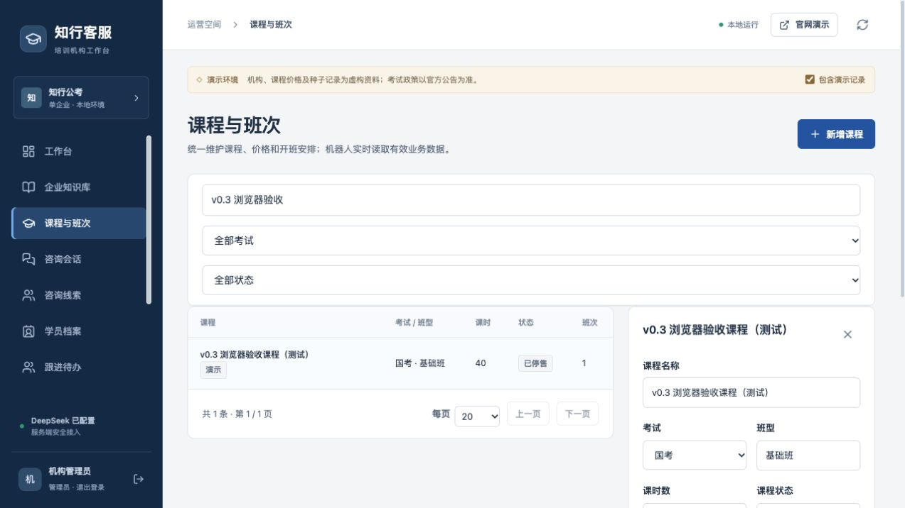
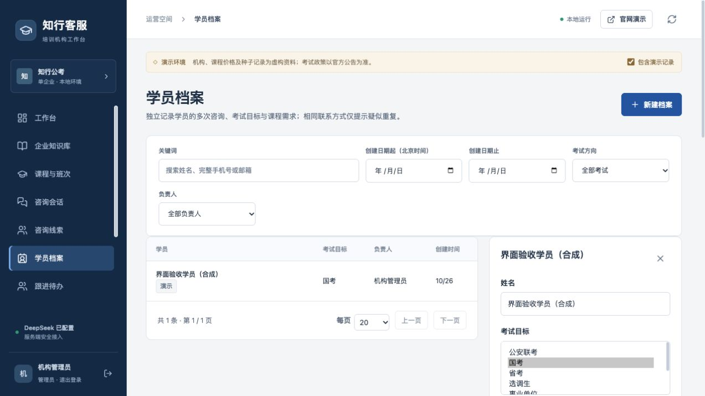
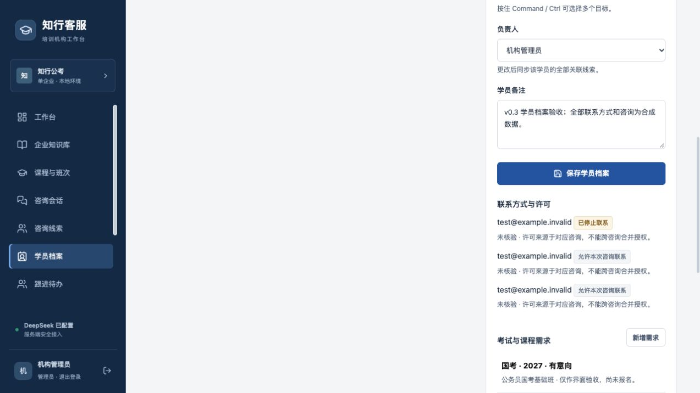
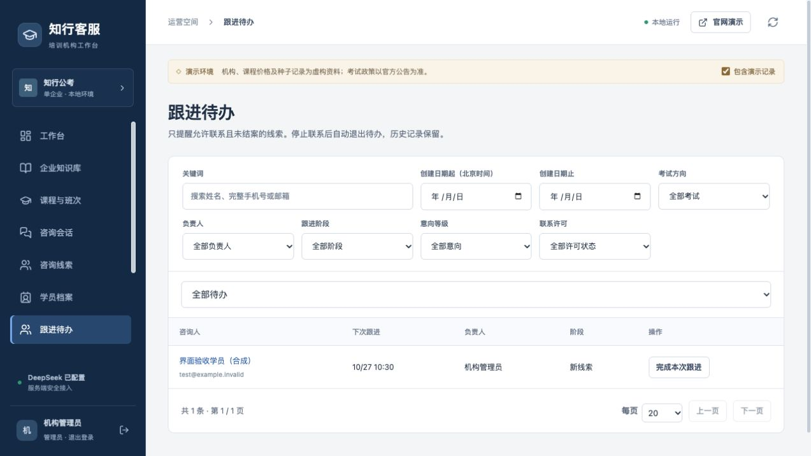

# v0.3：优化编号 4–6 验收记录

实施日期：2026-10-26 至 2026-10-27（北京时间）。完成用户已确认的课程班次、独立学员与跟进、分页筛选导出统计。中断发生在最终修复版 Docker 重建前；本次恢复后已补齐重建、PostgreSQL 并发复验、浏览器复验和交付记录。

## 完成功能

| 编号 | 交付内容 | 操作入口 |
| --- | --- | --- |
| 4 | 课程名称、考试、班型、课时、说明；多班次线上/线下/混合、地点、开班起止时间、售价及有效期；草稿、可报名、停售、满班、结束；机器人直接读取当前业务数据，旧价引用失效 | 课程与班次 |
| 5 | 独立学员档案关联多次咨询，维护考试目标、课程需求、年度、状态和备注；疑似重复提醒、人工核实后关联/合并、错误关联解除；下次跟进、逾期/今天/待跟进、完成待办和工作台提醒 | 学员档案、线索详情、跟进待办 |
| 6 | 服务端分页；日期、考试、负责人、阶段、意向、联系许可与关键词筛选；CSV 全量导出及统一统计查询；停止联系显著展示；知识与审计列表分页 | 咨询会话、线索、知识、学员、课程、企业设置、工作台与数据分析 |

## 验证结果

- 后端完整套件：**87 项通过，另有 8 个子测试通过**。测试禁用 DeepSeek Key，不产生模型调用费用。
- 前端传输测试：**4 项通过**；TypeScript、Vite 生产构建和最终 Docker 镜像构建通过。
- 升级前备份恢复到独立 `zhixing_v03_rehearsal` 演练库。首次升级保留原始行数：员工 2、知识 20、会话 14、消息 34、线索 12、跟进 3；没有删除真实业务数据。重复迁移通过。
- 最终核对补充匿名咨询和售后需求的考试筛选：没有留资或没有销售考试标签时仍能按当前考试需求检索；列表、CSV 查询和考试分布使用一致方向识别，SQLite 与 PostgreSQL 均通过。
- 真实 PostgreSQL 的并发改价、并发合并分别返回 **200 / 409**。525 条合成线索和会话验证跨页读取、JSON 考试筛选、CSV 和看板数量一致，超过旧 300/500 条上限。
- 真实 PostgreSQL 强制锁等待验证：旧顾问等待学员行锁期间发生负责人转交，恢复后返回 **404**；成交建档与关联并发、负责人调整与关联并发保持同一学员关系和负责人。
- **630 字合并原因**完整存入独立长文本审计详情，不再挤入 120 字操作名称字段。合并事务与审计同时提交。
- 实际运行容器冒烟：登录、公开知识检索、内部资料隔离、未知问题、留资、转人工、人工回复、会话隔离和演示排除通过；DeepSeek 配置保留，中文混合检索 `ready`。
- 浏览器：创建合成课程和班次、599 元结构化报价、停售；线索独立建档、负责人同步、添加 2027 年国考课程需求、多次咨询；人工合并合成档案后，原停止联系许可仍保留；设置及完成待办，停止联系记录不出现外呼提醒。
- 浏览器复现并修复统计筛选缺陷：请求后输入保持焦点；开始日期晚于结束日期时筛选器继续显示；修改结束日期后统计自动恢复。完成待办后列表归零并写入跟进记录。

## 独立审阅与修复

仅进行一次独立完整变更审阅。以下六类问题已完成失败回归或浏览器复现，再修复验证；未重复派发审阅：

1. `¥999`、无货币后缀的售价、中文金额等旧经营信息：普通参考文档不能覆盖结构化课程事实；课程自由文本禁止夹带金额或课时，历史遗留名称也会清理后再生成公开来源。
2. 学员锁前授权与锁后范围变化：取得锁后按当前员工范围重新读取，CRM 关系变更使用统一锁顺序。
3. 连续合并历史归属：历史链扁平化并同步全部来源档案，旧负责人不能读取历史节点。
4. 线索更新与建档/关联并发：锁后刷新关联关系，避免重复建档覆盖以及学员和线索负责人不一致。
5. 工作台/分析筛选器加载卸载：加载和错误只替换结果区，筛选器保持可编辑。
6. 长合并原因数据库长度不符：原因保存在审计 `details` 长文本中，后台可展开查看完整详情。

## 保留的业务规则与边界

- 沿用原本地功能分支，源代码和 Docker 运行目录保持一致，未增加独立工作区隔离或远程发布。
- 同一学员及关联线索采用同一负责人，管理员调整时整组同步；代价是当前不能把同一学员拆给多个顾问。
- 联系方式和许可从关联留资投影，不复制共享许可、不按同号自动认定身份；代价是本轮没有独立手工录入联系方式的联系人库。
- 课程经营事实在“课程与班次”维护，课程类型知识文件作参考存档；代价是上传旧价文件不能替代课程数据维护。考试政策仍使用原有来源、年度和地区限制。
- 普通用户及人工历史消息中的金额保留为原始对话，不视为机器人当前报价依据；代价是历史中仍可见对方曾提出的金额，但旧的机器报价会失效。
- 仍采用 offset 分页，新增记录期间不承诺冻结快照；课程需求选择器当前载入前 100 门课程。当前 8 个初始课程的规模内可用，扩大课程规模需补充搜索选择器。
- 启动 CRM 回填和概览仍有内存聚合；CRM 关系变更用企业级锁确保一致。当前测试规模通过，扩大业务规模前需评估索引、聚合和锁粒度。
- 本轮完成本地功能验收，未扩展原清单第 7–10 项，也不代表长期压测、生产 SLA、完整隐私生命周期或公网安全验收已完成。测试客户端弃用提示及前端大包提示保留为后续维护项。

## 演示数据与交付状态

课程页幂等初始化 8 个原演示基础班；另有明确标名的浏览器验收课程，已停售并标记演示。学员、合并来源、咨询及跟进验收记录均为合成数据，保留演示标识；旧验收员工仍处于停用状态。临时演练数据库和临时界面数据文件完成验证后清理，正式数据库及本地 Key 保留。

