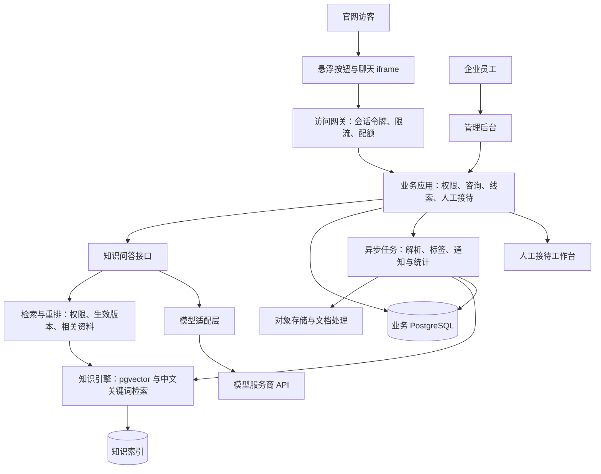

# 智能客服系统：可行性与完整实现方案

编制日期：2026-10-26  
文档性质：用于立项、评审和开发拆分的建议方案；尚未实施产品或使用企业真实资料完成效果验证。  
已确认范围：首期供一家企业自用，保留以后扩展为多企业产品的能力。

## 1. 结论与适用前提

**整体可行。** 后台管理、企业知识库、官网嵌入聊天、对话记录、线索管理、客户标签和经营分析都可以实现。建议通过“自研业务应用＋检索增强生成（RAG）＋可替换的大模型 API”落地，首期不训练基础大模型。

知识库问答的基本做法是先找出与问题相关、已审核且允许公开的企业资料，再让模型依据资料组织回答。上传资料通常触发解析和索引更新，并不等于训练了一个新模型。官网悬浮聊天入口也有成熟实现，Dify 官方文档即提供聊天气泡和 iframe 两类嵌入方式。[来源：Dify 官网嵌入文档](https://docs.dify.ai/en/cloud/use-dify/publish/webapp/embedding-in-websites)

可行不等于无条件承诺，以下要求需要调整为可验收的边界：

| 需求 | 判断 | 实际交付边界 |
| --- | --- | --- |
| 上传企业资料并回答问题 | 可行 | 文本质量、时效、权限与覆盖率决定效果；扫描文件需 OCR |
| 快速回答 | 可行 | 使用流式输出；具体延迟取决于检索、模型、网络与并发，需要压测 |
| 自动识别意向等级 | 可行，属于辅助判断 | 根据明确的对话证据与规则分级，保留“待判定”和人工改级 |
| 保存客户线索 | 可行 | 匿名访客先保存咨询记录；合法获取联系方式后形成可跟进线索 |
| 官网右下角机器人入口 | 可行 | 企业需要有插入脚本和配置相关安全策略的权限 |
| 自动展示实时价格、库存、订单 | 有条件可行 | 需要对接有授权的业务接口，不能仅凭过时文档回答 |
| 无资料也能保证回答准确 | 不可承诺 | 资料不足时澄清、明确未知或转人工 |
| 自动识别所有匿名访客真实身份 | 不可实现可靠保证 | 清理存储、跨设备和未登录访问都会限制身份连续性 |
| 保证客户等级等于真实成交概率 | 不可承诺 | 初期是业务规则评分；概率校准需要足够且可靠的成交反馈 |

以下为本方案的规划假设，尚非用户确认：首期面向普通企业售前与一般售后咨询，中文为主、网页文本聊天为主，优先按中国大陆部署考虑；日咨询约 1,000 个会话、每会话 8 轮问答，峰值同时生成 20 路，知识切片规模先按 10 万条以内设计。医疗、金融等专门行业需要追加业务与合规要求。实际规模超过假设时重新评估容量，不据此承诺固定服务器配置。

## 2. 实现路线与推荐选择

| 路线 | 做法 | 优点 | 代价与适用性 |
| --- | --- | --- | --- |
| A：采购现成客服 SaaS | 使用供应商后台、知识库、机器人及线索能力 | 上手快，运维工作少 | 深度流程、数据迁出、费用与功能受供应商限制；适合标准需求 |
| B：自研业务应用，组合成熟 AI 组件 | 自建后台、嵌入组件、线索和分析；复用检索、解析与模型服务 | 业务规则可控，模型可替换，投入适中 | 需要开发和运维能力；推荐用于本项目 |
| C：应用及模型推理全部私有化 | 自建应用、检索与模型服务，采购或租用 GPU | 对部署位置、模型版本和数据链路控制更强 | 需要推理运维和容量管理；严格隔离环境再考虑 |

**建议选择 B。** 业务数据由自己的应用管理，知识问答通过单独接口接入；初期采用成熟文档解析组件、PostgreSQL＋pgvector、模型 API，必要时接入知识库平台。全私有化不意味着必须从零训练模型。

Dify 可以作为知识库编排的候选，但不是默认依赖。其当前许可证对多租户运营和使用其前端时的品牌移除有额外条件；单企业场景也应按实际使用方式核对条款。未来转为多企业产品时，需要重新审查许可并取得适用授权，不能预设任何开源平台都可无限制用于 SaaS。[来源：Dify LICENSE](https://github.com/langgenius/dify/blob/main/LICENSE)

## 3. 产品范围、角色与业务闭环

### 3.1 两个产品入口，共用一套业务数据

1. **企业后台**：管理企业资料、知识发布、机器人、咨询、客户、销售跟进、人工接待、数据和权限。
2. **官网客服组件**：显示右下角悬浮按钮，承载访客咨询、答案来源、留资、转人工及反馈。

首期角色建议为：企业管理员、知识运营、客服、销售、只读分析人员。管理员分配权限；知识运营只能管理知识；客服接待和查看授权会话；销售查看本人或团队授权线索；分析人员默认只看脱敏汇总。平台运营角色留待多企业版本。

### 3.2 业务闭环

企业整理资料 → 上传与解析 → 审核发布 → 访客发起咨询 → 检索资料并回答 → 提取需求与证据 → 访客自愿留资 → 生成并分配线索 → 销售跟进 → 回填结果 → 调整知识与分级规则。

“咨询记录”“潜客线索”“客户”分别管理：所有有效咨询可有记录；有可用联系渠道和业务需求时进入线索池；成交或经人工确认已有业务关系后进入客户状态。浏览器随机访客标识只是假名标识，不代表数据已法律意义上的匿名化。

### 3.3 后台导航与功能

| 模块 | 首期功能 | 主要规则 |
| --- | --- | --- |
| 工作台 | 今日咨询、待接待、待跟进、知识异常、服务状态 | 点击指标可查看对应明细 |
| 企业设置 | 企业简介、产品、联系方式、营业时间、服务范围 | 展示字段与内部字段分开 |
| 知识库 | 文件上传、FAQ、分类、预览、版本、审批、上下架、检索测试 | 草稿不参与正式回答；保留更新责任人 |
| 机器人设置 | 名称、头像、欢迎语、推荐问题、回答范围、转人工规则 | 可预览与测试；变更有版本 |
| 咨询中心 | 会话检索、对话回放、来源、状态、客服接入、质检 | 能回溯回答所用知识版本 |
| 线索管理 | 去重、分级、负责人、分配、跟进、提醒、导出 | 联系方式校验；限制导出权限 |
| 客户管理 | 客户档案、联系人、历史咨询、标签、业务状态 | 线索可关联既有客户，合并可审计 |
| 标签与规则 | 标签字典、评分规则、证据、人工修正 | 区分访客明确陈述、模型提议、人工确认 |
| 数据分析 | 咨询、获客、接待质量、知识缺口、模型成本 | 指标定义固定，支持按来源与日期筛选 |
| 网站接入 | 接入代码、绑定域名、组件外观、接入检测 | 公开应用标识和服务端密钥分离 |
| 系统管理 | 账号、角色、权限、审计、留存策略、密钥配置 | 密钥只存服务端，敏感操作留痕 |

### 3.4 线索跟进状态

建议状态：新线索 → 待分配 → 跟进中 → 已合格 → 商机推进 → 已成交／已失效。另有重复、垃圾、待核实等辅助状态。每次状态变更记录操作者、时间和原因；已失效不等于删除。提醒和通知只在企业明确配置的渠道与授权范围内发送。

首期以网站内接待、后台提醒和手动跟进记录形成闭环；复杂 CRM、企业微信、邮件、短信和营销自动化作为后续集成，不作为首期上线依赖。

## 4. 系统架构与技术建议

### 4.1 逻辑架构

首期采用模块化单体业务应用，加独立任务进程；知识问答通过内部接口隔离。不要一开始拆成大量微服务。业务库与知识索引可以共用 PostgreSQL 实例，逻辑表、权限和备份策略分开。组件选型如下，开发团队可在不改变验收行为的前提下确定受支持版本：

| 层 | 建议 | 原因 |
| --- | --- | --- |
| 管理后台 | React＋TypeScript＋成熟后台组件库 | 表格、表单和权限页面效率较高 |
| 官网组件 | 小型 TypeScript 加载器＋独立聊天页面 | 便于隔离官网样式、按需加载与统一升级 |
| 业务 API 与 AI 编排 | Python FastAPI | 统一文档处理、检索及业务接口；团队已有强项时可替换 |
| 关系数据与向量 | PostgreSQL＋pgvector | 初期减少数据库种类，支持业务关联与向量检索 |
| 关键词召回 | 中文预分词后写入 PostgreSQL 全文索引 | 产品型号、缩写和术语需精确召回；建立企业词表 |
| 文件存储 | 兼容 S3 的对象存储 | 原件、解析产物和导出文件分权限保存 |
| 异步处理 | Celery＋Redis，任务状态以数据库为准 | 处理 OCR、索引、标签和统计；失败可重试与重放 |
| 实时链路 | HTTP 流式响应承载 AI；WebSocket 承载人工会话与接待状态 | 按交互需求使用，不统一强制某种传输 |
| 发布与观测 | 容器部署、反向代理、日志、指标、链路追踪 | 支持回滚、问题定位与模型成本核算 |

pgvector 官方说明支持与 PostgreSQL 全文检索组合，并通过排名融合或交叉编码器合并结果；因此可以实现混合检索，无需初期同时维护多个搜索系统。[来源：pgvector 混合检索文档](https://github.com/pgvector/pgvector#hybrid-search)

中文分词、企业词表和特殊型号归一化必须实测，不能直接依赖默认英文检索配置。小规模先做精确向量检索，数据扩大后按压测结果增加 HNSW 等索引；有权限过滤时同时检查召回率，不能只看查询速度。检索规模或复杂过滤显著增长时，再评估独立搜索服务。

### 4.2 模型选择

先选择两家在目标部署地区可用、企业条款适用的模型服务，使用同一企业测试集比较中文回答、引用忠实度、未知问题处理、延迟、结构化输出、并发配额和总成本。上线采用一个主模型；备用模型只有通过相同质量与数据处理审查后才能启用，否则故障时降级至已审核 FAQ 或人工服务。

服务商、模型名、版本、超时、重试和预算通过适配层配置。生成、向量化、重排可以使用不同模型。向量模型变更需重新构建兼容索引，不能把不同向量空间直接混合。普通问题使用标准模型，复杂问题才升级；不把更高价格等同于更好效果。

## 5. 企业知识库的实现

### 5.1 支持内容与发布流程

首期支持 FAQ、TXT、Markdown、DOCX、文本型 PDF；扫描 PDF 开启 OCR；XLSX 限定有明确列结构的产品、价格或参数模板，复杂表格需人工校正。官网页面同步从管理员明确指定的公开 URL 开始，暂不开放任意全网抓取。

文档状态：上传中 → 安全检查 → 解析中 → 待校对 → 待审核 → 已发布。失败状态展示原因并支持重试；未发布与下架资料不被机器人检索。

1. 检查文件大小、类型、实际内容与恶意文件；保存校验值用于重复识别。
2. 提取标题、段落、页码、表格及来源；OCR 低质量页面要求人工检查。
3. 清理乱码和重复页眉，保留型号、单位、表头和必要上下文。
4. 按语义章节切片，先以约 300–800 个模型 token、约 10%–20% 重叠作为试验范围，再用真实问答调整；完整 FAQ 尽量不拆散。
5. 写入来源位置、产品、语言、生效期、可见级别和知识版本。
6. 构建关键词及向量索引，完成检索试验后发布。

结构化价格以价格表或业务接口为权威来源；营销宣传、服务合同和产品说明发生冲突时，按企业配置的权威级别与有效日期处理，无法判断则转人工。单纯选择更新时间最近的一段不能保证正确。

### 5.2 更新、权限与删除

- 草稿与正式知识分开；新版本完成索引和验收后，原子切换生效版本，失败时保留旧版。
- 每次回答记录引用的片段与知识版本，便于追查；公众只查看允许公开的引用摘要或公开链接，不能借引用下载内部原件。
- 下架后立即通过有效性过滤阻止检索，并使相关缓存失效；物理索引清理异步完成。
- 删除原件、解析文本、向量、缓存、导出文件与备份恢复后的删除任务，按统一生命周期管理。
- 保留知识负责人、有效期、审阅时间和缺口处理记录；客户原话及客服修正不得未经审核自动发布为知识。

## 6. 知识问答流程、边界与降级

### 6.1 一次问答的处理链

1. 服务端验证会话身份、网站配置、所属企业、消息长度、频率和剩余额度。
2. 记录用户消息，识别咨询类别；多轮对话按需要改写当前检索问题。
3. 对正式、有效、允许公开的知识进行关键词＋向量召回，合并并重排。
4. 将排名靠前且通过权限校验的片段交给模型，回答必须遵循企业业务规则。
5. 依据检索覆盖度、资料一致性和答案支持度选择回答、澄清、拒绝猜测或转人工。
6. 对高风险事实做结构化校验，净化输出后返回；保存答案、引用、状态、版本、耗时与 token 用量。
7. 发送可靠的业务事件，异步生成标签建议与线索摘要；重试不得重复创建线索。

检索 Top-K、切片长度、重排阈值都属于需要调参的初始配置。相似度分数不能直接当作“正确概率”，模型自报置信度不能作为唯一放行标准。

### 6.2 回答规则

- 有充足资料：简洁回答并附资料来源。
- 问题不清楚：先问必要的澄清问题。
- 资料不足或冲突：说明尚无可靠依据，转人工或记录待答问题。
- 实时价格、订单、库存：只从获授权接口读取；没有接口时说明需要核实。
- 退款、赔偿、折扣、合同承诺：依已审核规则回答，需要例外审批时转人工。
- 用户明确要求人工：立即触发接待流程，不要求继续与机器人交谈。
- 投诉或售后需求：进入客服路径，不能因“低购买意向”减少应有服务。

流式回答在内容输出后不能完全撤回。普通资料回答可以分段流式返回；价格、承诺及其他需要完整核验的回答先验证，再输出。不能仅靠最后一步审核已经发出的文本。

### 6.3 故障处理

模型超时进行有界重试并使用幂等标识；主服务限流时仅切换到已审核备用服务。检索故障不得假装已经参考资料，改为审核 FAQ、人工或留言。网络断线允许用消息 ID 恢复状态，避免重复发送与收费。达到预算阈值告警并按明确策略限流，不能无声中断现有客户服务。

## 7. 自动标签与意向等级

### 7.1 标签分组与证据

| 维度 | 示例 | 保存方式 |
| --- | --- | --- |
| 咨询目的 | 产品了解、报价、购买、售后、投诉、合作 | 保存原话证据及消息 ID |
| 关注对象 | 产品系列、型号、功能、服务区域 | 匹配企业维护的产品字典 |
| 需求情况 | 明确用途、数量、预算、采购时间 | 未提及则为空，不自动补全 |
| 业务关系 | 新访客、潜客、已有客户 | 关系依登录、CRM 或人工确认 |
| 销售意向 | 待判定、一般了解、低／中／高意向 | 按版本化规则计算并可人工修正 |
| 服务优先事项 | 待人工、紧急售后、需报价核实 | 与销售意向独立 |

模型只输出候选事实、标签和对应证据，服务端进行结构校验及规则计算。保存标签来源、证据、规则版本、更新时间、人工修订及失效时间。不要把模型猜测变成客户档案事实，不依据姓名、口音等猜测年龄、收入、健康、民族或其他敏感属性。

### 7.2 可配置评分示例

此示例用于设计首期规则，不代表经过统计验证的成交预测：

| 明确证据 | 示例权重 |
| --- | ---: |
| 访客说明具体需求且匹配企业产品 | +25 |
| 主动要求报价、演示或销售联系 | +25 |
| 给出明确且较近的采购时间 | +20 |
| 给出预算或采购数量 | +15 |
| 自愿提供可核实联系方式并允许相关联系 | +15 |

每项只计一次，总分最高 100。信息不足时保持“待判定”；仅一般了解且无采购信号时列为“一般咨询”；有采购信号且总分低于 40 为低意向、40–69 为中意向、70 及以上为高意向。高意向还要求存在报价／演示／近期采购等至少一个明确行动信号。未留资不自动等于低意向，单独记录“可联系／不可联系”。

纯售后、投诉和垃圾咨询先按目的分流，避免误入销售等级统计。人工覆盖默认优先，后续模型分析不得覆盖锁定结果。对重复信号、否定句、条件句和前后矛盾做测试；超过企业配置的时间后重新评估，而非永久固定等级。

可以展示“高意向：询问 50 台报价，计划下月采购”，但不能展示未经验证的“成交概率 92%”。积累足够的已核实跟进和成交结果后，才讨论统计建模、校准与偏差监测。

## 8. 官网嵌入、会话身份与人工接待

### 8.1 接入方式

企业在官网加入异步加载脚本，配置公开应用标识。加载器创建右下角按钮；点击后才加载独立聊天 iframe。移动端采用适合窄屏的面板，支持关闭、键盘操作、焦点管理和屏幕阅读器。页面切换尽量保留同站会话；组件不可用时不阻塞官网主体。

官网需要配置脚本、frame、connect 等适用的 CSP 白名单，服务端配置允许嵌入来源。跨窗口通信验证 `origin`、`source`、消息类型与结构，发送时指定精确目标来源。[来源：MDN postMessage 安全说明](https://developer.mozilla.org/en-US/docs/Web/API/Window/postMessage)

### 8.2 身份与权限

- 公开 `app_id` 只用于定位配置，不能作为数据库、后台或模型调用的长期密钥。
- 访客创建会话后获得短期、仅绑定该会话和企业的令牌；会话 ID 本身不是读取历史的授权凭据。
- 历史恢复使用独立高熵恢复凭据并支持轮换、失效；不在 URL、统计平台或错误日志中传递电话、邮箱及恢复凭据。
- 匿名会话优先使用官网同站存储保存假名标识与恢复凭据，初始化时经受控通道传入组件；必要时通过企业同站代理改善兼容性。清理存储后允许新建会话。
- 若官网已登录，可由官网服务器签发短期身份声明；不能信任浏览器直接传入的姓名、客户 ID 或企业 ID。
- 跨设备合并只通过已验证身份或人工核实进行；不能用 IP 或浏览器指纹认定同一个人。

嵌入式服务不能依赖所有浏览器都允许第三方 Cookie。需在主流浏览器及禁用第三方 Cookie 的环境验证降级行为。[来源：MDN 第三方 Cookie 说明](https://developer.mozilla.org/en-US/docs/Web/Privacy/Guides/Third-party_cookies)

域名白名单、CORS 和 CSP 属于浏览器侧约束，不能单独防止伪造请求。公开入口仍需速率限制、配额、风险验证和滥用监测；敏感访问必须使用服务端鉴权。

### 8.3 留资与接待

访客可以先咨询，再自愿提交联系电话或邮箱、称呼与需求。提交前清晰说明用途；后续营销许可与本次咨询回复的授权分开记录。联系方式可用验证码等方式核验；未核验信息标为“待核实”。

会话接待状态：机器人接待 → 请求人工 → 排队 → 人工接待 → 已结束／退回机器人。人工接管后暂停机器人自动回复；转回机器人需要明确操作。无坐席或非营业时间提供留言及预计处理规则，不虚构等待时长。接待时把对话摘要、资料引用和已获得的客户信息交给客服，减少重复提问。

## 9. 主要数据结构与接口

### 9.1 核心数据实体

| 实体 | 关键字段或关系 |
| --- | --- |
| 企业与应用 | `tenant_id`、企业设置、网站、机器人配置、允许域名 |
| 员工与权限 | 用户、成员关系、角色、团队、数据范围 |
| 知识库 | 知识库、文档、文档版本、片段、来源、权限、有效期、索引版本 |
| 访客与身份 | 假名访客标识、已验证身份、身份关联依据 |
| 会话与消息 | 企业、网站、访客、消息序号、接待状态、回复状态、引用、模型版本 |
| 联系人与客户 | 联系方式、验证状态、客户组织、已有业务关系 |
| 线索与跟进 | 需求、等级、负责人、阶段、最近跟进时间、失效原因 |
| 标签与评分 | 字典、关联记录、证据消息、规则版本、人工覆盖 |
| 同意与隐私请求 | 目的、范围、告知版本、时间、撤回、访问／更正／删除请求 |
| 运行与审计 | 任务、事件、外发投递、用量、费用、操作审计、评测结果 |

同一访客可有多次会话，同一联系人可关联多个设备和多个采购需求。线索按需求或销售机会建立，不能仅因电话号码相同就把不同商机覆盖。联系方式在企业范围内去重，疑似重复由人工确认。敏感字段加密，需要查重时使用服务端带密钥摘要，不以简单哈希替代保护。

### 9.2 接口分组

以下为规划接口，不表示已经实现：

| 分组 | 示例接口与行为 |
| --- | --- |
| 组件初始化 | `GET /widget/config`，仅返回公开配置 |
| 创建与恢复会话 | `POST /widget/sessions`、`POST /widget/sessions/resume` |
| 发送消息 | `POST /widget/sessions/{id}/messages`，支持幂等与流式响应 |
| 访客留资 | `POST /widget/sessions/{id}/contact`，保存用途授权与验证状态 |
| 人工接待 | `POST /widget/sessions/{id}/handoff`；坐席接管与消息接口 |
| 知识管理 | 上传、解析进度、预览、检索测试、审批、发布与下架接口 |
| 业务管理 | 会话、联系人、客户、线索、跟进、分配、标签和规则接口 |
| 分析与运维 | 指标、缺口、用量、错误、审计和隐私请求接口 |

后台接口统一鉴权、授权、字段校验、分页和错误格式。租户上下文由服务端会话确定，不接受客户端任意指定；所有对象读取与写入都验证所属企业和权限。事件投递采用事务 outbox，异步消费者幂等，失败进入可查看、可重试的队列。

## 10. 分析指标与运营机制

首期统计按企业、网站、日期、来源、产品、咨询目的与负责人查看。事件包含唯一 ID、事件时间、处理时间、企业与关联实体；以统一报表时区聚合，并处理重试去重和迟到事件。

| 指标 | 建议定义 |
| --- | --- |
| 有效咨询会话数 | 至少发送过一条有效用户消息的会话；排除测试与已识别垃圾流量 |
| 留资率 | 有新有效联系信息的咨询会话数 ÷ 有效咨询会话数；标明是否已验证 |
| 合格线索率 | 经人工确认合格的线索数 ÷ 有效新增线索数 |
| 自助完成率 | 经用户确认或抽检认可、且观察窗口内未因同一问题再次求助的机器人会话 ÷ 可由机器人处理的会话 |
| 转人工率 | 实际触发人工请求的会话数 ÷ 有效咨询会话数 |
| 回答质量 | 人工标注样本中的正确、资料支持和拒答是否适当；分别统计 |
| 知识缺口 | 未解决问题按主题聚类并记录负责人、状态及后续发布知识 |
| 服务质量 | 首个有效回答延迟、人工首次响应、接待等待、满意度与投诉 |
| 业务结果 | 联系、合格、演示、报价、成交等阶段转化；需要销售回填 |
| 模型成本 | 生成、标签、向量化、重排分别计量；支持会话及每条有效线索成本 |

用户离开或关闭面板不自动等于问题解决；点赞率不等于准确率；没有业务结果回填时不能宣称机器人带来多少成交。分析看板区分观测到的关联与因果，运营初期不承诺提升固定百分比。

建议每周抽查真实问答、复核高意向标签和跟进结果，处理过期与缺失知识；每次更换模型、规则或知识处理方式，先跑固定回归集再灰度。

## 11. 安全、数据保护与上线条件

### 11.1 应用与 AI 安全

1. 文档分为公开客服知识、员工内部知识和受限资料；公众入口仅访问明确允许公开的范围。内部资料不能依靠提示词保密。
2. 检索、引用、缓存、对象下载、日志、导出和异步任务都执行权限过滤。缓存键至少包含企业、应用、权限范围和知识生效版本；个人会话缓存不能跨人复用。
3. 用户输入和检索资料都作为不可信内容。模型不能持有数据库管理凭据，不能任意执行 SQL、访问网址或调用工具；工具白名单、参数和业务授权由服务端控制。
4. 防范提示注入、恶意文档、敏感信息外泄；不宣称 RAG 或一句“只依据知识库回答”可以消除攻击。[来源：OWASP 提示注入说明](https://genai.owasp.org/llmrisk/llm01-prompt-injection/)
5. 对 URL 同步阻止内网、回环、元数据地址及危险重定向，避免 SSRF；文件解析限制资源和超时，解析进程隔离。
6. 聊天 Markdown 和模型生成链接进行净化与白名单处理，禁止危险 HTML；后台使用安全会话、防 CSRF、管理员强认证及最小权限。
7. 联系方式和敏感字段加密、日志脱敏、导出授权、对象存储私有化；模型输入尽量不包含非必要联系方式。密钥有轮换、审计与失效机制。
8. 对公共聊天接口做多维限流、并发和预算控制；识别滥用时按风险增加验证，不能把域名校验当作唯一鉴权。

### 11.2 中国大陆部署下的数据与服务合规

这是实施工作项，需要结合行业、主体和部署地区确认适用要求，而非已完成合规审核：

- 对咨询、留资和标签分别确定处理目的与合法基础，履行必要告知；基于同意的处理支持撤回，提供查阅、更正、删除等请求入口；委托处理需约定职责。[来源：《个人信息保护法》](https://www.miit.gov.cn/jgsj/zfs/fl/art/2022/art_515a4b20c12f430eab54bb4f56d89f56.html)
- 若客户分级涉及个人信息自动化决策，需考虑透明、公平与解释、拒绝机制；不能把规则分数用于不合理差别价格或完全自动作出有重大权益影响的决定。营销拒绝机制单独落实。[来源：《个人信息保护法》第二十四条](https://www.miit.gov.cn/jgsj/zfs/fl/art/2022/art_515a4b20c12f430eab54bb4f56d89f56.html)
- 优先按境内存储与处理路径设计；确认模型、OCR、重排、监控和人工运维的实际数据流向、保存时间、训练使用及删除条款。境内托管不自动意味着所有数据都不出境；涉及出境时再判断适用程序，不能一概声称所有企业数据均必须境内存储。
- 官网面向公众提供生成式客服不能简单套用“内部自用不适用”的例外。根据服务属性核对生成式 AI、内容治理、备案／登记或安全评估等适用义务，调用已有模型 API 不等于应用主体所有义务已完成。[来源：《生成式人工智能服务管理暂行办法》](https://www.cac.gov.cn/2023-07/13/c_1690898327029107.htm)
- 界面明确提示 AI 服务；若适用生成合成内容标识要求，落实展示及复制、下载、导出时的相应标识，不能只在欢迎语写一次就认为完成全部要求。相关办法和配套标准已于 2025-09-01 实施。[来源：国家网信办标识办法说明](https://www.cac.gov.cn/2025-03/14/c_1743654685896173.htm)
- 结合实际运营方式核对网站备案、网络安全及行业专门义务；保留投诉举报和人工服务渠道。首期不收集与咨询无关的敏感信息，不引入无必要的跨站跟踪。

留存时间由企业按处理目的与适用要求确定，配置咨询、线索、审计和备份的不同期限，不能预设永久保存。备份中的删除按既定周期执行，恢复后重新应用删除记录，防止已删除资料重新进入在线系统。

## 12. 部署、可靠性与后续多企业扩展

### 12.1 首期部署

开发、测试和生产隔离；测试用脱敏或合成数据。生产优先使用托管数据库、对象存储和可恢复的 Redis，应用与任务进程独立扩容。至少部署两个应用副本后再承诺应用侧连续服务；数据库高可用与恢复能力按预算选择。单机演示环境不能视作正式生产的高可用方案。

监控包括服务错误、首个有效文本延迟、完整回答耗时、模型限流、检索空结果、索引积压、标签任务失败、人工排队、存储、令牌用量和费用。每个会话有可关联的 trace ID，追踪默认脱敏。

发布采用版本化配置与数据库迁移，支持回滚；模型、提示词、评分规则、知识版本分别管理。恢复目标初步建议 RPO 不超过 1 小时、RTO 不超过 4 小时，具体取决于所购基础设施，并通过真实恢复演练确认。

### 12.2 为扩展保留边界，不提前建设全部 SaaS 功能

首期所有业务表、知识、对象存储路径、事件和缓存都带企业标识，后台只有一家企业的管理流程；不建设自助注册、套餐计费和平台运营门户。

多企业版本新增：企业开通、成员邀请、独立配置、租户配额、计费、平台审计、跨租户访问防护、可选独立数据库及企业迁移。必须用至少两个测试企业验证检索、会话、对象下载、缓存、导出与异步任务的隔离，不能仅检查后台列表。

数据库使用行级安全作为防线时，应用角色不能是超级用户或拥有 `BYPASSRLS`；需考虑表所有者默认绕过策略的行为，迁移角色与应用角色分开。[来源：PostgreSQL 行级安全文档](https://www.postgresql.org/docs/18/ddl-rowsecurity.html)

“首期保留企业标识”可以减少迁移成本，不等于已经满足多企业商业上线要求。

## 13. 实施阶段、人员与交付物

以下周期是按范围稳定、资料及时、现有官网允许接入、团队具备相关经验作出的工程估算，未经项目排期与工作量核定，不是工期保证。

| 阶段 | 参考周期 | 工作与交付物 |
| --- | --- | --- |
| 0：资料与效果验证 | 第 1–2 周 | 收集 50–100 份代表资料与 200–300 个问题，建立测试集；验证解析、召回、模型、官网接入、数据链路和许可 |
| 1：基础闭环 | 第 3–5 周 | 后台账号和权限、知识发布、官网组件、流式问答、引用、会话与留资；演示完整咨询链路 |
| 2：运营能力 | 第 6–8 周 | 客户和线索、标签证据、评分、分配跟进、基础人工接待、分析、知识缺口 |
| 3：上线验证 | 第 9–10 周 | 真实场景评测、安全与隔离测试、压测、故障演练、备份恢复、企业试用和修复 |
| 预留 | 第 11–12 周 | 处理复杂资料、接口与验收偏差；资料或审批延迟会影响排期 |

建议投入：前端 1 人、后端／AI 工程 2 人、测试约 0.5 人，产品与企业知识负责人、设计和运维按阶段参与。不能把知识整理、答案审核和销售反馈完全外包给模型；企业方需指定负责人。

首期交付包含：需求及权限矩阵、源代码与部署配置、数据库迁移、接口说明、嵌入说明、知识运营流程、测试集与评测报告、权限与安全验证结果、备份恢复记录、监控和应急手册、管理员培训资料、软件许可清单。

首期暂缓语音、全渠道接入、复杂 CRM、自动营销、完整订单处理、自主交易操作、多企业计费及基础模型训练。后续按实际需求与业务效果追加。

## 14. 成本测算方法

### 14.1 开发投入

按首期约 8–12 人月的有效工程及协作工作量估算，假设企业采用每人月 2–4 万元的综合成本，则基础预算约 16–48 万元；加 20% 预留约 19–58 万元。此处单价仅为可替换的预算假设，不是市场报价；采购 SaaS、外包、内部团队和已有组件的成本结构不同。GPU、专门审计、第三方授权及复杂集成另行核算。

### 14.2 模型费用

设每日会话数为 D、每会话问答轮数为 T、计费天数为 N，则主回答请求数 Q＝D×T×N。每次平均输入 I 个 token、输出 O 个 token，输入与输出每百万 token 的价格分别为 P_in、P_out：

`主回答费用＝Q×I÷1,000,000×P_in＋Q×O÷1,000,000×P_out`

例如 D＝1,000、T＝8、N＝30、I＝3,500、O＝350，则 Q＝240,000，月输入约 8.4 亿 token、输出约 8,400 万 token，费用为 `840×P_in＋84×P_out`。若仅为演示代入假设单价 P_in＝2 元、P_out＝8 元，结果为 2,352 元／月；**这不是任何服务商的实际报价**。

输入应包含系统规则、历史摘要和检索片段。标签提取、问题改写、向量化、重排、OCR、失败重试和备用模型另外计费；若模型另有推理等计费项也需加入。缓存折扣只有核对服务商规则并确认实际命中后才能纳入预算。

### 14.3 基础设施与日常运营

应用、数据库、对象存储、缓存、日志、流量、备份、告警、验证码和可选商业授权分别报价。普通试点可先将不含 GPU、模型及人力的云资源作为每月 2,000–8,000 元的规划区间，再按部署地域、数据库高可用、保留量与压测核定；这同样是预算假设，不是云厂商报价。

总运行费用＝基础设施＋全部 AI 调用＋外部服务／许可＋知识维护与客服运维人力。需要同时观察每会话费用、每有效线索费用及跟进质量，不能只比较模型 token 单价。

## 15. 验收与上线门槛

所有指标均为建议立项目标，尚未实测；企业应在阶段 0 用真实资料确认难度与口径，不能把表中数值当作既有产品性能。

| 维度 | 建议验收方式与目标 |
| --- | --- |
| 流程完整性 | 上传→发布→官网咨询→引用→留资→标签→分配→跟进→统计全部可演示和追溯 |
| 检索 | 在明确有答案的独立测试集上评估 Recall@5，初始目标 ≥90%；按产品和资料类型分组 |
| 回答质量 | 有答案样本由企业专家盲评，正确且有资料支持的答案占比初始目标 ≥90%；严重错误单独记录 |
| 未知问题处理 | 对缺失、冲突和不应回答的问题，正确澄清／拒答／转人工的占比初始目标 ≥95% |
| 引用 | 引用真实存在、属于生效版本且用户有权访问；引用支持结论，不能仅有链接 |
| 标签 | 先人工标注 100–200 个会话，高意向识别 precision 初始目标 ≥85%，同时报告 recall、覆盖率和待判定比例 |
| 身份与线索 | 未验证身份不自动合并；同一消息重试不重复建线索；未留资不会凭空生成联系方式 |
| 延迟 | 在指定网络、模型和资料规模下，20 路同时生成，首个有效回答文本 P95 目标 ≤5 秒、标准短答完整返回 P95 目标 ≤15 秒；分别报告失败率 |
| 人工接待 | 排队、接管、断线、离线留言可运行；接管后机器人不重复抢答 |
| 安全 | 公开入口无法访问内部资料或其他会话；验证 IDOR、XSS、提示注入、SSRF 和文件攻击；发现严重漏洞须修复后上线 |
| 数据质量 | 测试流量排除、事件重试去重、指标可由明细复核；成交指标有明确数据来源 |
| 可靠性 | 模型超时、配额耗尽、索引失败与任务重试有降级；恢复演练满足已约定 RPO／RTO |
| 服务可用性 | 首月观测目标 99.5%，明确监测口径、排除项及上游故障影响；是否承诺更高 SLA 另行评估 |

延迟从请求发送到首个包含有效回答内容的文本计算，欢迎语或“正在思考”不算；20 路生成指服务端同时处理生成请求，不等于只有 20 个网站访客。

测试集区分可回答、不可回答、多轮、型号精确匹配、过期／冲突、扫描件、表格、攻击与身份权限等类型。调参集和验收集分开，验收问题不能只照抄 FAQ；报告样本量、失败案例和局限。人工评审不只依赖另一个模型打分。

## 16. 风险、阻断条件与下一步

| 风险或阻断条件 | 影响 | 处理办法 |
| --- | --- | --- |
| 没有可用资料或资料严重冲突 | 无法可靠回答企业事实 | 先整理 FAQ 与权威文件，审核后逐步扩大范围 |
| 企业无权修改官网，安全策略不可调整 | 无法按要求嵌入现有网站 | 与网站维护方确认接入权限；独立咨询页只作为临时替代 |
| 资料禁止发送外部服务 | 当前 API 方案不成立 | 改用满足要求的私有化模型及 OCR／向量／重排链路，重新评估成本 |
| 模型输出编造价格或承诺 | 业务损失 | 权威结构化来源、规则核验、未知降级与人工审批 |
| 标签被误当成事实 | 销售错配或不公平待遇 | 证据、待判定、人工覆盖与规则复盘 |
| 匿名身份错合并 | 隐私暴露和客户档案污染 | 只按验证身份合并，保留拆分与审计 |
| 公开入口滥用 | 调用费用失控、服务变慢 | 配额、限流、异常检测、预算和有序降级 |
| 企业无人维护知识和跟进 | 技术上线但业务闭环失败 | 指定知识负责人、接待及销售负责人，落实更新和响应制度 |
| 后续多企业运营超出组件许可 | 许可与迁移风险 | 提前保留适配层，商业化前完成条款及隔离审查 |
| 要求绝对正确、无限速度或完全无人值守 | 验收目标不可满足 | 改为限定场景和明确指标；不接受无法验证的保证 |

**建议先执行两周的效果与接入验证，再按结果进入正式开发。** 最少准备：代表性企业资料、200–300 个真实问题及参考答案、官网接入权限、希望收集的线索字段、客户等级业务规则、人工接待安排和数据处理约束。行业、实际日咨询量、峰值、现有 CRM、云账号及最终预算属于开发启动前的待确认输入；其余不影响现在给出可行性结论。

若验证表明部分资料类型或模型效果达不到门槛，应缩小自动回答范围并使用人工兜底；如果网站接入权限或数据处理路径无法满足，则相应功能不能按当前方案上线。当前没有发现使整个项目在技术上不可行的依据，是否正式立项应同时依据资料质量、试测结果和业务投入。
